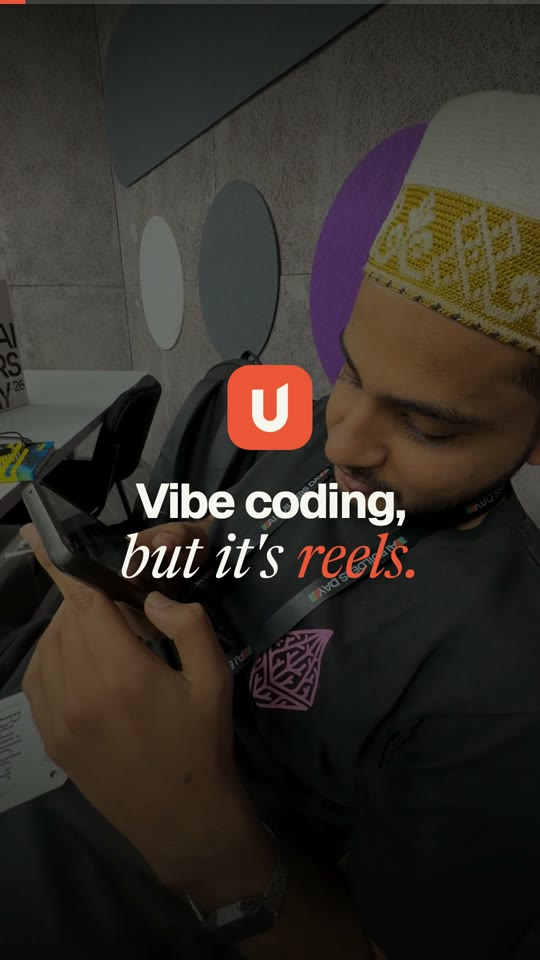

# Unvibe

Understand what your coding agent shipped, in a feed you already know how to use.

<p align="center">
  <a href="demo/demo.mp4"></a>
  <br>
  <sub>▶ <a href="demo/demo.mp4">Watch the 1-minute demo</a></sub>
</p>

This repository includes both the original curated Instagram-style demo and a real local workflow: select a saved Claude Code transcript, review its redacted contents, generate a lesson with the installed Claude CLI, optionally narrate it with ElevenLabs, render a vertical MP4, and save the lesson in your browser's private feed.

## Firebase deployment

Production: **https://unvibe-learnagram.web.app** in Firebase project `personal-projects-e8a07`, on its own Hosting site `unvibe-learnagram`.

Landing-page signups use Firestore's REST API and save normalized emails into the default database's **`unvibeSignups`** collection. Each row has `email`, server `createdAt`, `source`, and versioned launch-email `consent`. Security rules bind the document ID to the SHA-256 email hash, preventing duplicate rows. Retrying an existing signup can only make an exact no-op write, preserving its original timestamp. The form confirms success only after Firestore acknowledges the commit; it never substitutes localStorage for a database save. This is a launch waitlist, not account authentication or a payment flow.

View signups in the [Firebase database console](https://console.firebase.google.com/project/personal-projects-e8a07/firestore/databases/-default-/data/~2FunvibeSignups). Public reads, list queries, deletions, and changes to existing records are denied. Rules validate the field schema, normalized email, consent, source, hash, and server timestamp. The Firebase web API key is public app configuration; access is enforced by rules. This works on the project's current Spark plan without Cloud Functions or a billing upgrade. Anonymous signup writes do not provide email ownership verification or server-side rate limiting; add App Check or a server endpoint before a larger campaign if abuse becomes a concern.

To redeploy using Node.js 24+ and Firebase CLI 15.22+:

```sh
npm ci
npm test
npm run test:signups
npm run deploy
```

The deployment is scoped to this Hosting site and the Firestore rules file. `firestore.rules` preserves the project's existing rules and adds only the `unvibeSignups` match; review any newer console changes before redeploying the complete rules file. No functions are deployed. Hashed assets receive long-lived caching; the HTML, manifest, and service worker revalidate. `/app` and `/connect` use the SPA fallback. Signup requests use `no-store` and bypass the service worker cache.

The hosted `/connect` page offers an allowlisted companion source archive. Download and extract it on the computer running Claude Code, then follow its install/start commands. The companion stays on localhost; browser local-network permission may be needed. Its default allowed origins include the two Unvibe Firebase domains. No transcript or pairing token is submitted to Firestore or Firebase Hosting.

## Run locally

Requires Node.js 24+ and the [official Claude Code CLI](https://code.claude.com/docs/en/setup). Install and authenticate Claude Code normally; Unvibe does not collect Claude passwords, OAuth tokens, or subscription credentials.

```sh
npm install
npm run dev
```

The app opens at **http://127.0.0.1:5174**. In a second terminal, from this repository:

```sh
npm run companion
```

Open the private `/connect` pairing link printed in that terminal, or open **http://127.0.0.1:5174/connect** and paste the companion token. Keep the companion terminal running. The companion listens only on `127.0.0.1:4318`; the token authorizes access to your local session metadata and selected transcripts, so keep the link private.

1. Use Claude Code in your own project so a session is saved under `~/.claude/projects`.
2. Pair the browser and choose a session from the list.
3. Expand the transcript review. Common secrets are redacted automatically, but review the content yourself before sending it.
4. Choose **Claude Code** to generate a new explanation, or explicitly choose **Local transcript summary** for an extractive, non-AI version.
5. Choose MP4 export and optional narration, then generate. Claude generation requires the consent checkbox and uses your own provider access and usage limits.
6. Review the result, download its MP4, or add it to your feed. Adding to the feed saves the validated lesson and embedded audio in this browser's IndexedDB; it does not publish anything to other people.

The original `/app` sample feed and simulated Create flow remain available. They are labeled as samples and are not used as a fallback when real generation fails.

## Install as an app

Unvibe is a PWA. Test the production version locally:

```sh
npm run build
npm run preview -- --host 127.0.0.1 --port 4173 --strictPort
```

Open **http://127.0.0.1:4173/app**. Choose **Install** in the desktop sidebar or **Install Unvibe** under mobile **Profile**. Chromium browsers show their native installation prompt when available; the button otherwise explains the browser's installation steps. On iPhone and iPad, use Safari's **Share → Add to Home Screen**. On Mac Safari, use **File → Add to Dock**. Installing opens the familiar feed in its own window.

The first visit to `/app` or `/connect` downloads about 20 MB for offline use, including all demo narration and sound effects. Wait for **Ready to go offline** before disconnecting. The app shell, demo reels, and lessons already saved to this device remain available offline. Browser storage can be cleared or evicted; download MP4s you want to keep permanently. New Claude lessons and narration still require the local companion and provider connectivity. Pair again if your installed browser uses separate storage. A phone's `127.0.0.1` points to the phone itself, so installing on a phone does not connect it to the desktop companion.

Updates show an explicit **Update** button and wait until you are ready to reload. The service worker caches app assets and demo audio only; companion responses and authorization-bearing requests are not cached. Local lessons remain in IndexedDB. The landing page does not start the offline download until the app is opened.

For deployment, serve `dist/` over HTTPS (localhost is also supported), rewrite app routes such as `/app` and `/connect` to `index.html`, and revalidate `sw.js`, `index.html`, and `manifest.webmanifest` rather than serving them with immutable caching. Vite's development server intentionally does not register the production service worker. Regenerate the matching app icons with `npm run pwa:icons`.

## Optional narration

Set this server-only value in `.env.local`, then restart the companion:

```dotenv
ELEVENLABS_API_KEY=your_own_key
```

The existing narration key, if already configured locally, is used only when **Add voice narration** is selected. Generated script text is sent to ElevenLabs; original transcripts are not sent to the voice provider. The local companion loads `.env.local`; no `VITE_` credential is needed or appropriate. Voice failures are reported explicitly rather than silently exporting a video without the requested voice.

## Commands

| Command | Purpose |
| --- | --- |
| `npm run dev` | Vite app on `127.0.0.1:5174`, fails clearly if the port is occupied |
| `npm run companion` | Local session bridge and durable generation/render queue |
| `npm run build` | TypeScript checks and production frontend build |
| `npm run pwa:icons` | Regenerate the app, Apple touch, and maskable PNG icons |
| `npm run package:companion` | Build the allowlisted companion download and checksum |
| `npm run test:signups` | Signup persistence, duplicate, failure, and validation tests |
| `npm run deploy` | Package, build, deploy this Hosting site and Firestore rules |
| `npm test` | Local API, parser, security, queue, provider, and narration regression tests |
| `npm run test:pipeline` | Content-derived fixture → local analysis → real MP4, no Claude call |
| `npm run test:pipeline -- --live-claude --narrate` | Opt-in live Claude + ElevenLabs + MP4 smoke test; uses provider quota |

The smoke test uses only a committed non-sensitive fixture, never your actual session history. Artifacts are written to ignored `output/pipeline-smoke/`. `--no-render` skips encoding. The test leaves its local job data in the OS temporary folder for diagnosis.

## How it works

```text
Claude Code saved JSONL session
  → user-selected, redacted transcript + review hash
  → unmodified Claude CLI, tools and project hooks disabled
  → validated lesson JSON
  → optional ElevenLabs narration with scene alignment
  → Remotion: 1080×1920, 30 fps, H.264 MP4 + AAC when narrated
  → preview / download / private browser library
```

The CLI is invoked from an isolated app-data directory with a bounded prompt, structured output, no tools, no MCP servers, and no project execution. Unvibe never resumes or edits the source project. Tool requests are treated as attempted actions, not proof of success; lessons are instructed to preserve unverified outcomes.

The companion runs one job at a time. Jobs and generated media survive restarts in the app-data directory. Interrupted work is marked failed rather than automatically consuming provider quota again. Cancel requests stop child processes/rendering. Export can be retried without generating the lesson again.

Generated-reel questions currently use a clearly labeled local lookup of that lesson's content. They are not a live Claude conversation. Demo comments and polls retain their original scripted behavior.

## Configuration

These are companion-only environment variables. The defaults work with the local app:

| Variable | Default / use |
| --- | --- |
| `LEARNAGRAM_COMPANION_PORT` | `4318` |
| `LEARNAGRAM_FRONTEND_URL` | `http://127.0.0.1:5174/`; the printed link points to `/connect` |
| `LEARNAGRAM_ALLOWED_ORIGINS` | Exact local Vite/preview origins on ports 5173–5175 and 4173 plus the two Unvibe Firebase domains; use comma-separated origins for another trusted frontend |
| `LEARNAGRAM_CLAUDE_PROJECTS_DIR` | `~/.claude/projects` |
| `LEARNAGRAM_CLAUDE_BIN` | `claude` on PATH |
| `LEARNAGRAM_CLAUDE_MODEL` | `sonnet` |
| `LEARNAGRAM_COMPANION_DATA_DIR` | OS application-data folder; macOS: `~/Library/Application Support/Learnagram` |
| `LEARNAGRAM_COMPANION_TOKEN` | Optional externally managed 32–128 character URL-safe pairing secret; normally generated automatically |
| `LEARNAGRAM_CHROME_PATH` | Optional local Chrome executable for MP4 rendering |
| `ELEVENLABS_API_KEY` | Optional own voice-provider key |
| `LEARNAGRAM_ELEVENLABS_VOICE_ID` | Optional ElevenLabs voice override |

Connection settings and media are stored with owner-only permissions. Browser pairing is remembered for the current tab session. To revoke a pairing token, stop the companion, remove only its `connection.json` (keep `jobs.json` and `media/` to preserve your work), and restart it to create a new token. Existing browser pairings must then reconnect. Disconnecting the browser forgets its token but does not stop an already running job; use **Cancel this job** for that.

## Pricing and release scope

See [pricing and unit economics](docs/pricing.md). The demo and local app currently charge no Unvibe platform fee; Claude and ElevenLabs access are supplied by the user. Cloud Pro is a proposed $19/month plan, visibly marked not launched. This repository does not process subscriptions or card payments and does not provide cloud accounts, multi-device sync, remote-agent tunneling, or automated writes back into Claude sessions.

A hosted HTTPS frontend can require browser local-network permission and an explicit allowed origin to reach the localhost companion. The documented and verified default is the local frontend plus local companion; no public tunnel is created.
